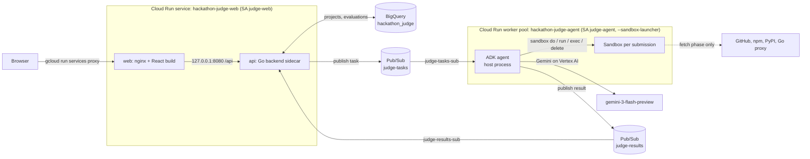
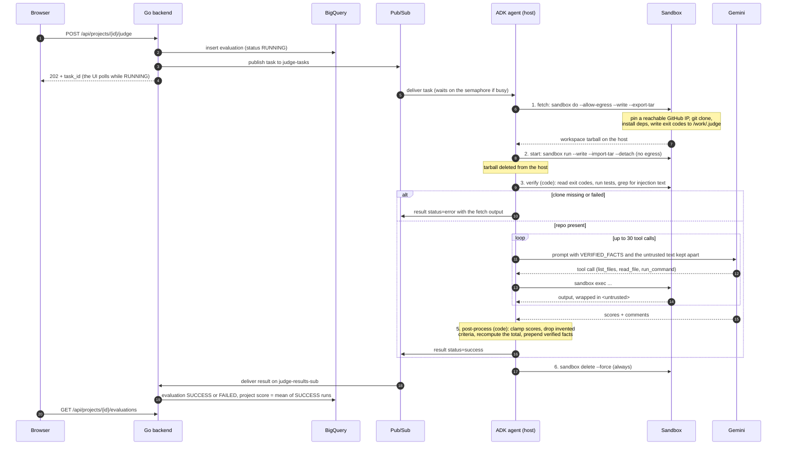
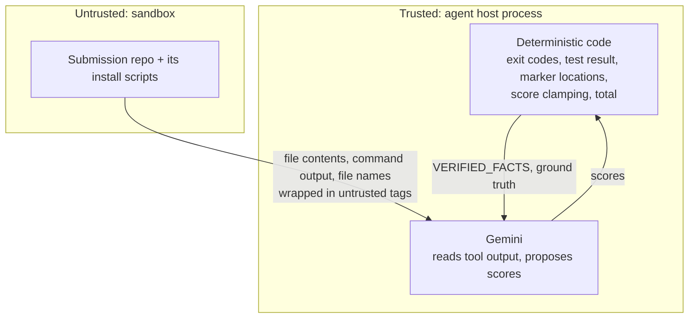

# Architecture: Hackathon Judge on Cloud Run

How the Cloud Run port works, as deployed and measured in `asia-southeast2` (October 2026).
For deploy steps and the list of fixes, see [README-CLOUDRUN.md](README-CLOUDRUN.md).

## Overview

Two Cloud Run resources, two Pub/Sub topics and one BigQuery dataset. There is no GKE cluster.

## Components

| Component | What runs | Identity and access | Size |
| --- | --- | --- | --- |
| `hackathon-judge-web` (service) | `web`: nginx serving the React build, proxying `/api/` to the sidecar with the prefix kept. `api`: Go backend (Gin), not reachable from outside the instance | `judge-web`: BigQuery data editor + job user, publisher on `judge-tasks`, subscriber on `judge-results-sub` | 1 vCPU / 512 Mi per container, `minScale 1`, `maxScale 3`, CPU always allocated (the results pull stays open) |
| `hackathon-judge-agent` (worker pool) | ADK agent pulling `judge-tasks-sub`. Launches sandboxes with the binary at `/usr/local/gcp/bin/sandbox` | `judge-agent`: Vertex AI user, subscriber on `judge-tasks-sub`, publisher on `judge-results`. Sandboxes cannot use it | 4 vCPU / 8 Gi, 1 instance, 1 evaluation at a time |
| Sandboxes | One per submission, created by the agent. They share the instance's CPU and memory | None: no host env vars, no secrets, no metadata server | Read-only view of the agent image's file system, plus a writable `/work` |
| Pub/Sub | `judge-tasks` (ack deadline 600 s), `judge-results` | | |
| BigQuery | `hackathons`, `projects`, `evaluations` | | |
| Artifact Registry | `backend`, `frontend-cloudrun`, `agent-cloudrun` images, built by Cloud Build | | |

The web UI is private: there is no `allUsers` invoker binding unless you deploy with `PUBLIC=true`.

## One submission, end to end

## Sandbox lifecycle

| Phase | CLI | Network | Timeout | Measured |
| --- | --- | --- | --- | --- |
| Fetch | `sandbox do --allow-egress --write --export-tar=<tmp>/fetch.tar -- bash -c FETCH_SCRIPT` | Allowed | 600 s overall; clone and install 300 s each | 9–23 s (npm projects), 89 s (Python venv + pip) |
| Start | `sandbox run <id> --write --import-tar=<tar> --detach -- sleep 1800` | Blocked | 60 s | 0.6–1.4 s |
| Verify | `sandbox exec <id> -- ...` (exit codes, test runner, grep) | Blocked | tests 300 s | 0.4–3.9 s |
| Judge | `sandbox exec` for each model tool call | Blocked | 30 s per read, 120 s per command | 48–91 s |
| Delete | `sandbox delete <id> --force`, in `finally` | | 60 s | ~20 ms |

What runs where:

- **Fetch script**, inside the sandbox. It probes GitHub IPs with a 5 s connect timeout and pins the
  first one that answers (`git config --global http.curloptResolve`). Then it runs
  `git clone --depth 1`, then `npm`/`pnpm`/`yarn install`, a Python venv with `pip install` plus
  `pytest`, or `go mod download`. Exit codes go to `/work/.judge/*.exit`. A failed install is
  recorded, not fatal.
- **Verify script**, inside the sandbox. Picks the first runner that applies: `npm test`,
  `go test ./...`, `python -m pytest -q` or `make test`.
- **Every `exec`** runs from `/work/repo` (or `/work`) and exits with 97 if neither exists, so it
  can never fall back to the agent's own code in `/app`.

## Trust boundaries

The design rules (also in `CLAUDE.md`):

1. **The model never runs in a sandbox.** The agent and its Vertex AI credentials stay on the host.
   The sandbox only runs commands it is sent.
2. **Egress only during fetch.** The judging sandbox is offline. The startup self-check confirms that
   a sandbox without `--allow-egress` can't reach the internet.
3. **Nothing secret in an image.** Sandboxes can read the agent image's files, so the image only holds
   code and toolchains.
4. **One evaluation per instance.** Sandboxes share CPU and memory with the agent. Scale with more
   worker-pool instances.
5. **Facts come from code.** Test results, injection markers, score clamping and the total are
   computed, never taken from the model. Only marker *locations* (`path:line`) reach the trusted
   facts, never the matched text.
6. **Submission text is untrusted.** Everything from the repo or the submission form is wrapped with
   `wrap_untrusted()`, which escapes any `<untrusted>` tags inside so the text can't close the wrapper.

Known gaps: install scripts (for example npm `postinstall`) run with internet during the fetch phase,
without credentials. File names reach the model inside `list_files` output, wrapped as untrusted. The
grep for injection text is a tripwire, not a defense.

## Failure handling

| Failure | What happens |
| --- | --- |
| Clone fails or the workspace tarball has no repo | Evaluation ends with `status: error`. `error_message` carries the fetch output. The model is not called |
| Fetch sandbox killed (seen when GitHub IPs were unreachable) | `--export-tar` writes nothing usable. Handled as above |
| Agent exception at any step | `status: error`. The sandbox is still deleted |
| Evaluation stays `RUNNING` for more than 15 min | The backend watchdog, which checks every 5 min, marks it `FAILED` |
| Result for a task with no evaluation row (for example a hand-published smoke task) | The backend nacks it, and Pub/Sub redelivers forever. There is no dead-letter topic |

## Scaling and limits

- One instance judges one submission at a time, about 1–2 minutes each. Other tasks wait in Pub/Sub
  (ack deadline 600 s, extended by the client library).
- Because of the 15-minute watchdog, more than about 10 submissions queued on one instance can show
  `FAILED` in the UI while they are still being judged. Raise `AGENT_INSTANCES` before a batch.
  Each instance is 4 vCPU / 8 Gi and bills while it runs.
- The web service keeps one instance warm (`minScale 1`). The first BigQuery query after a cold
  start took about 10 s.

## Observability

| Log line (worker pool) | Meaning |
| --- | --- |
| `"event": "sandbox_self_check"` | At startup: `launcher_ok` and `egress_blocked_by_default` must both be `true` |
| `[start]` / `[end] exit_code=… elapsed=…` | Written by the sandbox launcher for every `do`, `run`, `exec` and `delete` |
| `Verified facts for <task>` | The facts computed by code, before the model runs |
| `Fetch sandbox exited …` | Fetch output when the fetch sandbox exits non-zero |
| `"event": "judge_metrics"` | One line per submission: status, `total_s`, `fetch_s`, `start_s`, `verify_s`, `agent_s`, tests, marker count |

Follow a submission live with
`gcloud beta run worker-pools logs tail hackathon-judge-agent --region=asia-southeast2`.

## Configuration

| Variable | Default | Where |
| --- | --- | --- |
| `AGENT_TYPE` | `cloudrun` | agent (`adk` and `sandbox_direct` are the original GKE paths) |
| `JUDGE_MODEL` | `gemini-3-flash-preview` | agent |
| `GOOGLE_GENAI_USE_VERTEXAI`, `GOOGLE_CLOUD_LOCATION` | `true`, `global` | agent |
| `MAX_CONCURRENT_EVALS` | `1` | agent |
| `JUDGE_MAX_TOOL_CALLS` | `30` | agent |
| `SANDBOX_BIN` | `/usr/local/gcp/bin/sandbox` | agent |
| `TASKS_TOPIC`, `RESULTS_SUB`, `BQ_DATASET` | `judge-tasks`, `judge-results-sub`, `hackathon_judge` | backend |
| `GOOGLE_CLOUD_REGION`, `AGENT_INSTANCES`, `PUBLIC` | `asia-southeast2`, `1`, `false` | `cloudrun/deploy-cloudrun.sh` |
