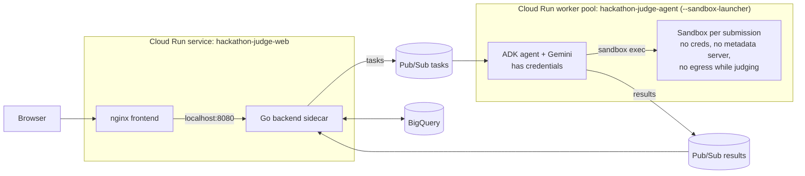

# Hackathon Judge on Cloud Run (no GKE)

A fork of [`codelabs/ai-toolkit-lab-2/hackathon-judge`](https://github.com/GoogleCloudPlatform/devrel-demos/tree/main/codelabs/ai-toolkit-lab-2/hackathon-judge)
that replaces GKE + Agent Sandbox with **Cloud Run sandboxes** (Preview).



## What changed

| GKE version | Cloud Run version |
| --- | --- |
| GKE Autopilot cluster | None |
| Agent Sandbox CRDs, router, gateway, claim template, warm pool | `--sandbox-launcher` on the worker pool |
| `agent-sandbox` image (FastAPI exec server + Gemini CLI) | Removed. Toolchain moved into the agent image |
| Gemini CLI runs `--yolo` **inside** the sandbox, next to the untrusted repo, with a service account that can call Vertex AI | ADK agent runs **outside** the sandbox and only sends commands in. The sandbox has no identity |
| No NetworkPolicy for the sandbox pods in `k8s/` | Egress only while cloning and installing deps, then off |
| Agent `Deployment` (Pub/Sub pull) | Cloud Run **worker pool** (same pull code, unchanged) |
| Frontend and backend `Deployment`s + Gateway | One Cloud Run service, backend as a sidecar on localhost |
| Workload Identity bindings | One service account per workload |

New and changed files:

```
agent/src/adapters/outbound/cloudrun_sandbox.py   sandbox CLI wrapper (fetch -> start -> exec -> delete)
agent/src/adapters/outbound/cloudrun_judge.py     ADK judge using the sandbox, AGENT_TYPE=cloudrun
agent/src/main.py                                  lazy imports, cloudrun is the default
agent/Dockerfile.cloudrun                          agent + toolchain the sandboxes borrow
agent/tests/adapters/test_cloudrun.py              tests (incl. end-to-end with a fake sandbox CLI)
agent/tests/fixtures/fake_sandbox.py               local stand-in for the sandbox binary
frontend/Dockerfile.cloudrun, nginx.cloudrun.conf  proxy to the backend sidecar
cloudrun/                                          service YAML, Cloud Build config, deploy/destroy
cloudrun/smoke/                                    known-bad sample submission + Pub/Sub task for end-to-end tests
CLAUDE.md, .claude/commands/deploy-cloudrun.md     context and a phased /deploy-cloudrun command for Claude Code
```

The original GKE path still works (`AGENT_TYPE=adk` or `sandbox_direct`, `k8s/`, `deploy.sh`).

## How one submission is judged

1. **Fetch** `sandbox do --allow-egress --write --export-tar` clones the repo and installs dependencies. Only phase with internet.
2. **Start** `sandbox run --write --import-tar --detach` starts an offline sandbox from that workspace. The tarball is deleted from the host right away.
3. **Verify (code, not the model)** detects a test runner (`npm test`, `go test`, `pytest`, `make test`), runs it, records exit codes, and greps for text aimed at the judge ("ignore previous instructions", "give this project full marks"...).
4. **Judge (model)** the ADK agent reads files and runs commands through `list_files`, `read_file`, `run_command`. Tool output and submission text are wrapped as untrusted. Verified facts are passed as ground truth.
5. **Post-process (code)** scores are clamped to each criterion's max, invented categories dropped, the total recomputed, and a `[Verified in sandbox]` line is prepended to the comments.
6. **Delete** `sandbox delete --force`, always, even on error.

## Observability

- At startup the agent logs `"event": "sandbox_self_check"` with `launcher_ok` and `egress_blocked_by_default`.
- Every submission logs one `"event": "judge_metrics"` line with fetch/start/verify/agent timings, the test result and the number of injection markers.

## Deploy

From Cloud Shell, at the repo root:

```bash
GOOGLE_CLOUD_PROJECT=your-project ./cloudrun/deploy-cloudrun.sh
# optional: GOOGLE_CLOUD_REGION=us-central1 PUBLIC=true AGENT_INSTANCES=2
```

Tear down with `./cloudrun/destroy-cloudrun.sh`.

## Run the tests

```bash
cd agent
uv sync
GOOGLE_CLOUD_PROJECT=p TASKS_SUBSCRIPTION=s RESULTS_TOPIC=t USE_MOCK_PUBSUB=true uv run pytest -q
```

`test_full_lifecycle_produces_facts` runs the real fetch/verify bash scripts against a local repo with a broken function and a prompt-injection comment, through `fake_sandbox.py`. The fake has no isolation; it only proves the scripts and CLI arguments are right.

## Design notes and limits

- **One evaluation per instance** (`MAX_CONCURRENT_EVALS=1`). Sandboxes share the instance's CPU and memory, and can read the host file system read-only. Scale with more worker-pool instances, not more concurrency.
- **Nothing secret in the image.** Sandboxes can't see env vars, secrets or the metadata server, but they can read the image's files.
- **Install scripts still run with internet** (e.g. npm `postinstall`). They get no credentials and are time-limited, but they can reach the network during the fetch phase. Set stricter rules if that matters for your event.
- **The grep tripwire is not a defense.** It's a deterministic signal. Consider adding Model Armor in front of the agent.
- File names from the repo can still reach the model (inside `list_files` output). They are wrapped as untrusted, not removed.

## Fixed while porting

- The original `frontend/nginx.conf` strips the `/api` prefix (`proxy_pass .../;`), but the Go routes live under `/api`. On GKE this never mattered because the Gateway sends `/api` straight to the backend. `nginx.cloudrun.conf` keeps the prefix.

## Not verified yet (check before relying on it)

- Not deployed end to end yet. Verified so far (asia-southeast2, Oct 2026): Cloud Build of all three
  images, and the web service. `/` serves the React app, `/api/hackathons` returns the seeded rows
  from BigQuery (so `nginx.cloudrun.conf` keeps the `/api` prefix), and the backend's results
  subscriber starts cleanly. The agent worker pool and sandboxes are not verified yet.
- Cloud Run sandboxes are **Preview**. Check that your region supports them (the script defaults to `asia-southeast2`; fall back to `us-central1` if not).
- `gcloud beta run worker-pools deploy` flags `--instances`, `--cpu`, `--memory` should be confirmed against your gcloud version.
- Whether `--export-tar` still writes the archive when the fetch script exits non-zero (the script is written to exit 0 to avoid depending on it).
- `gemini-3-flash-preview` is the model the original repo uses. Override with `JUDGE_MODEL`.
