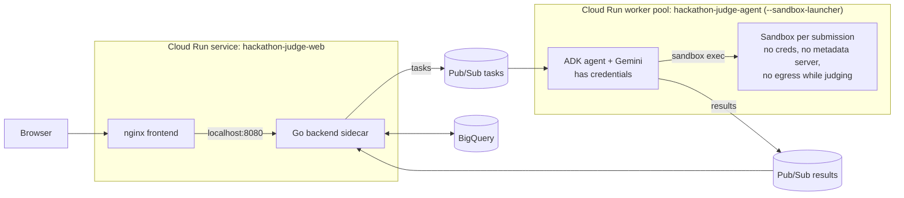

# Hackathon Judge on Cloud Run (no GKE)

A fork of [`codelabs/ai-toolkit-lab-2/hackathon-judge`](https://github.com/GoogleCloudPlatform/devrel-demos/tree/main/codelabs/ai-toolkit-lab-2/hackathon-judge)
that replaces GKE + Agent Sandbox with **Cloud Run sandboxes** (Preview).



## What changed

| GKE version | Cloud Run version |
| --- | --- |
| GKE Autopilot cluster | None |
| Agent Sandbox CRDs, router, gateway, claim template, warm pool | `--sandbox-launcher` on the worker pool |
| `agent-sandbox` image (FastAPI exec server + Gemini CLI) | Removed. Toolchain moved into the agent image |
| Gemini CLI runs `--yolo` **inside** the sandbox, next to the untrusted repo, with a service account that can call Vertex AI | ADK agent runs **outside** the sandbox and only sends commands in. The sandbox has no identity |
| No NetworkPolicy for the sandbox pods in `k8s/` | Egress only while cloning and installing deps, then off |
| Agent `Deployment` (Pub/Sub pull) | Cloud Run **worker pool** (same pull code, unchanged) |
| Frontend and backend `Deployment`s + Gateway | One Cloud Run service, backend as a sidecar on localhost |
| Workload Identity bindings | One service account per workload |

New and changed files:

```
agent/src/adapters/outbound/cloudrun_sandbox.py   sandbox CLI wrapper (fetch -> start -> exec -> delete)
agent/src/adapters/outbound/cloudrun_judge.py     ADK judge using the sandbox, AGENT_TYPE=cloudrun
agent/src/main.py                                  lazy imports, cloudrun is the default
agent/Dockerfile.cloudrun                          agent + toolchain the sandboxes borrow
agent/tests/adapters/test_cloudrun.py              tests (incl. end-to-end with a fake sandbox CLI)
agent/tests/fixtures/fake_sandbox.py               local stand-in for the sandbox binary
frontend/Dockerfile.cloudrun, nginx.cloudrun.conf  proxy to the backend sidecar
cloudrun/                                          service YAML, Cloud Build config, deploy/destroy
cloudrun/smoke/                                    known-bad sample submission + Pub/Sub task for end-to-end tests
CLAUDE.md, .claude/commands/deploy-cloudrun.md     context and a phased /deploy-cloudrun command for Claude Code
```

The original GKE path still works (`AGENT_TYPE=adk` or `sandbox_direct`, `k8s/`, `deploy.sh`).

## How one submission is judged

1. **Fetch** `sandbox do --allow-egress --write --export-tar` clones the repo and installs dependencies. Only phase with internet.
2. **Start** `sandbox run --write --import-tar --detach` starts an offline sandbox from that workspace. The tarball is deleted from the host right away.
3. **Verify (code, not the model)** detects a test runner (`npm test`, `go test`, `pytest`, `make test`), runs it, records exit codes, and greps for text aimed at the judge ("ignore previous instructions", "give this project full marks"...).
4. **Judge (model)** the ADK agent reads files and runs commands through `list_files`, `read_file`, `run_command`. Tool output and submission text are wrapped as untrusted. Verified facts are passed as ground truth.
5. **Post-process (code)** scores are clamped to each criterion's max, invented categories dropped, the total recomputed, and a `[Verified in sandbox]` line is prepended to the comments.
6. **Delete** `sandbox delete --force`, always, even on error.

## Observability

- At startup the agent logs `"event": "sandbox_self_check"` with `launcher_ok` and `egress_blocked_by_default`.
- Every submission logs one `"event": "judge_metrics"` line with fetch/start/verify/agent timings, the test result and the number of injection markers.
- The UI only shows `RUNNING` / `SUCCESS` / `FAILED`. To watch a submission step by step (fetch, start, verify, every command the model runs, delete):

```bash
gcloud beta run worker-pools logs tail hackathon-judge-agent --region=asia-southeast2
```

## Deploy

From the repo root (`codelabs/ai-toolkit-lab-2/hackathon-judge`):

```bash
GOOGLE_CLOUD_PROJECT=your-project ./cloudrun/deploy-cloudrun.sh
# optional: GOOGLE_CLOUD_REGION=us-central1 PUBLIC=true AGENT_INSTANCES=2
# BUILD_ONLY=true stops after Cloud Build
```

The script is safe to rerun: existing topics, dataset, service accounts and seed data are reused.
The web UI is private by default. Open it locally:

```bash
gcloud run services proxy hackathon-judge-web --region=asia-southeast2 --port=8080
```

Both the web service (`minScale: 1`) and the worker pool run, and bill, until you delete them:

```bash
GOOGLE_CLOUD_PROJECT=your-project ./cloudrun/destroy-cloudrun.sh
# asks for confirmation; YES=true skips it, DROP_DATA=true also drops the BigQuery dataset
```

Artifact Registry images and service accounts are kept, so the next deploy is faster.

## Smoke test

`cloudrun/smoke/sample-submission/` is a known-bad repo: a broken `add()`, a failing test, a network
call and prompt-injection text in `README.md` and `app.py`. Push it to a public GitHub repo, put the
URL in `cloudrun/smoke/task.json`, then:

```bash
gcloud pubsub subscriptions create judge-results-debug --topic=judge-results --expiration-period=1d
gcloud pubsub topics publish judge-tasks --message="$(cat cloudrun/smoke/task.json)"
gcloud pubsub subscriptions pull judge-results-debug --auto-ack --limit=1
```

Expected: `status: success`, tests detected and FAILED, 2 injection markers, low Execution and
Honesty scores. The backend will log `evaluation with ID smoke-001 not found` and nack the result
in a loop, because no evaluation row exists for a task that didn't come from the API. Stop it with
`gcloud pubsub subscriptions seek judge-results-sub --time=$(date -u +%Y-%m-%dT%H:%M:%SZ)`.
For the normal path, use the UI or `POST /api/projects/<id>/judge`.

## Run the tests

```bash
cd agent
uv sync
GOOGLE_CLOUD_PROJECT=p TASKS_SUBSCRIPTION=s RESULTS_TOPIC=t USE_MOCK_PUBSUB=true uv run pytest -q
```

`test_full_lifecycle_produces_facts` runs the real fetch/verify bash scripts against a local repo with a broken function and a prompt-injection comment, through `fake_sandbox.py`. The fake has no isolation; it only proves the scripts and CLI arguments are right.

## Design notes and limits

- **One evaluation per instance** (`MAX_CONCURRENT_EVALS=1`). Sandboxes share the instance's CPU and memory, and can read the host file system read-only. Scale with more worker-pool instances, not more concurrency.
- **Nothing secret in the image.** Sandboxes can't see env vars, secrets or the metadata server, but they can read the image's files.
- **Install scripts still run with internet** (e.g. npm `postinstall`). They get no credentials and are time-limited, but they can reach the network during the fetch phase. Set stricter rules if that matters for your event.
- **The grep tripwire is not a defense.** It's a deterministic signal. Consider adding Model Armor in front of the agent.
- File names from the repo can still reach the model (inside `list_files` output). They are wrapped as untrusted, not removed.

## Fixed while porting

- The original `frontend/nginx.conf` strips the `/api` prefix (`proxy_pass .../;`), but the Go routes live under `/api`. On GKE this never mattered because the Gateway sends `/api` straight to the backend. `nginx.cloudrun.conf` keeps the prefix.
- **GitHub egress from sandboxes.** From sandboxes in `asia-southeast2`, GitHub's Asian edge IPs
  (`20.205.243.166`, `20.27.177.113`) never connect, while `140.82.x` works. The host container reaches
  all of them. DNS returns either, so clones failed at random (4 of 7 at first): git hung, the sandbox
  was killed after ~150 s, and `--export-tar` failed with `failed to tar container: exit status 128`.
  The fetch script now probes the DNS answers plus known-good fallbacks and pins the first reachable
  IP with git's `http.curloptResolve`.
- **Judging an empty workspace.** When the fetch produced no repo, `exec` fell back to the launcher's
  cwd (`/app`), so the grep and the model read the agent's own source and reported `success`. Now
  `exec` never runs outside `/work`, and a missing clone ends the evaluation with `status: error`
  and the fetch output in `error_message`.
- **Reruns duplicated seed data.** `seeds.sql` is plain INSERTs; the deploy script now seeds only an
  empty table.
- **Destroy targeted the wrong project.** `destroy-cloudrun.sh` used the active `gcloud config`
  project. It now pins `GOOGLE_CLOUD_PROJECT` and asks before deleting.

## Verified on Cloud Run (asia-southeast2, Oct 2026)

- gcloud 584.0.0 (beta 2026.09.04): `gcloud beta run worker-pools deploy` accepts
  `--sandbox-launcher --cpu=4 --memory=8Gi --instances=1`, and the sandbox CLI accepts `--` before
  the command.
- Web service: `/` serves the React app, `/api/hackathons` returns BigQuery rows through nginx, and
  the backend's results subscriber starts.
- Agent: `sandbox_self_check` passes (`launcher_ok`, `egress_blocked_by_default`). `sandbox do` takes
  ~0.1 s.
- Smoke test: tests detected and FAILED, 2 injection markers, total 2/30.
- 8 seeded TypeScript projects judged through the UI/API, all `success`. Per submission: fetch
  9–23 s, start 0.1–0.7 s, verify < 2.5 s, model 48–91 s, total 63–112 s.
- `--export-tar` works when the script exits normally (207 MB tar for a 193 MB `node_modules`
  workspace), and writes nothing usable when the sandbox process is killed.

## Not verified yet (still open)

- `egress_blocked_by_default` only means "curl failed inside the sandbox". The fetch phase reaching
  GitHub with `--allow-egress` is the positive control.
- The GitHub fallback IPs in `FETCH_SCRIPT` are hardcoded. If they go stale, take new ones from
  `https://api.github.com/meta`. npm git dependencies use the pinned IP too; other hosts on the
  same blocked ranges would still hang.
- The backend nacks results with no matching evaluation forever (no dead-letter topic).
- `gemini-3-flash-preview` is the model the original repo uses. Override with `JUDGE_MODEL`.
